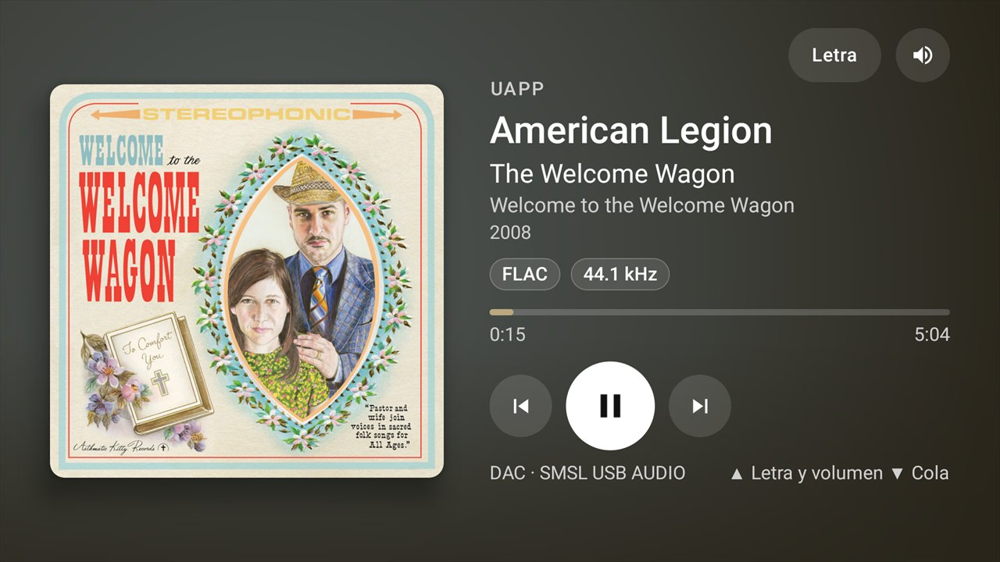

# DAC Stage

[English](README.md) · **Español**



Capturas y documentación completa (en inglés): [README.md](README.md).

Una sola APK con tres roles:

- **Host** (tablet o teléfono con el DAC USB): UAPP, HiBy u otra app de música reproducen de forma nativa hacia el DAC. DAC Stage publica lo que suena, recibe comandos y es el único que habla USB con el DAC (volumen y mute por hardware).
- **TV** (Android/Google TV): solo visualiza y controla — transporte, cola, letra y volumen del DAC. No reproduce, no tiene biblioteca, no hace streaming.
- **Control remoto** (teléfono o tablet): lo mismo que la TV con controles táctiles y sin salvapantallas. Publica lo que suena como sesión multimedia de Android (notificación, pantalla de bloqueo, teclas de volumen). Se conecta por la red o, si la Wi‑Fi aísla a los equipos entre sí, por Bluetooth.

La app **nunca** decodifica ni transmite audio, y no tiene ningún respaldo de menor calidad. En una TV (leanback) el rol es siempre TV; en un teléfono o tablet se elige la primera vez (host o control remoto) y se puede cambiar después.

## Compilar

```powershell
.\gradlew.bat assembleDebug          # app\build\outputs\apk\debug\app-debug.apk
.\gradlew.bat assembleRelease        # R8 + shrinkResources
.\gradlew.bat :app:testDebugUnitTest # pruebas unitarias
```

Requisitos: JDK 17 o posterior (probado con 25), Android SDK con `platforms;android-37.0` (`local.properties` → `sdk.dir`). Firma de release: crea `keystore.properties` en la raíz (`storeFile`, `storePassword`, `keyAlias`, `keyPassword`); sin él, release se firma con la clave debug. Si publicas tu propia versión, define `dacstage.projectUrl` en `gradle.properties` (va en el User-Agent de MusicBrainz y LRCLIB).

## Instalar

```powershell
$adb = "<ruta del SDK>\platform-tools\adb.exe"
& $adb -s <ip-tv>:5555 install -r app\build\outputs\apk\release\app-release.apk        # TV
& $adb -s <ip-tablet>:<puerto> install -r app\build\outputs\apk\release\app-release.apk # tablet
```

Reinstalar en la tablet reinicia el permiso USB del DAC: acepta "Solicitud de conexión USB" al abrir la app.

## Primer uso en el host

1. Abre DAC Stage en la tablet. Arranca el servicio en primer plano (notificación "Host activo").
2. **Acceso a notificaciones**: la app lo pide si falta. Es lo que permite leer las MediaSessions de HiBy y UAPP (no lee notificaciones).
3. **Permiso USB** del DAC: acéptalo cuando aparezca.
4. (Opcional) **Cola de UAPP**: Ajustes → "Leer la cola de UAPP". Ver más abajo.

## Emparejar host y TV

1. Abre DAC Stage en la TV. Busca el host por NSD/mDNS (`_dacstage._tcp`, puerto 47820). Si no lo encuentra, permite IP manual.
2. La TV muestra un **código de 6 dígitos**.
3. En el host: Ajustes → Emparejar TV → escribe el código. Queda guardado; las reconexiones se autentican solas (HMAC con token).
4. Para desemparejar: Ajustes del host → TVs emparejadas → Olvidar. La TV vuelve a mostrar un código.

Puertos: 47820 (estado y comandos, JSON por líneas) y 47821 (carátulas por HTTP con token). Si están ocupados se usan los siguientes libres y se anuncian por NSD.

## Volumen del DAC (seguridad)

- Lo impone el **host**, también cuando el comando viene de la TV: tope configurable (por defecto 10 dB bajo el máximo, −10 dB en el SMSL), pasos de 1 dB, aceleración gradual con tope al mantener pulsado, mute siempre disponible. La TV no puede cambiar el tope ni pedir un volumen absoluto.
- Se muestra siempre el valor **releído del DAC**, nunca el pedido.
- Si HiBy/UAPP tienen la interfaz AudioControl, tomarla exige `claimInterface(true)`. En pausa se hace sin preguntar; **con música sonando** solo si confirmaste en el host ("Permitir siempre con <reproductor>", guardado por DAC + reproductor y revocable) o con "Pausar y aplicar". Si no, la TV muestra "Volumen no disponible ahora".
- Si suena otra app que no es HiBy ni UAPP, nunca se toma el control sin confirmación.

## Limitaciones conocidas

- **UAPP — cola**: UAPP no publica su cola por MediaSession. Se lee de sus archivos (`PlayQueue.xml`, `PosA.txt`, `PosB.txt` en `Android/data/com.extreamsd.usbaudioplayerpro/files/UAPP/`), que una app normal no puede leer en Android 11+. DAC Stage usa la **depuración inalámbrica de la propia tablet** como cliente ADB local (emparejado una vez con el código de Opciones de desarrollador → Depuración inalámbrica → "Vincular dispositivo con código"). Es opcional y explícito; sin él, la cola de UAPP se oculta. Solo lee esos tres archivos (lista blanca, `cat`/`stat`). La depuración inalámbrica se apaga al reiniciar o cambiar de Wi-Fi: hay que reactivarla para volver a ver la cola.
- **UAPP — salto en la cola**: `skipToQueueItem` no está implementado por UAPP. Se avanza con N × siguiente/anterior (tope 40 pasos, cancelable con Atrás); la TV muestra "Avanzando…". Si el archivo y la sesión no coinciden, la cola se oculta (nunca se simula). La app **nunca** llama `playFromSearch`/`playFromMediaId` (en UAPP vacían la cola); una prueba unitaria lo verifica.
- **HiBy**: la TV solo navega lo que ya está en la cola de HiBy (su MediaBrowser solo ofrece biblioteca local). HiBy no publica formato ni bitrate: esos chips no aparecen (la lectura pasiva de pantalla está prevista como opción desactivada por defecto y aún no implementada).
- **DAC**: no hay selector de fuente por USB. El DAC no avisa cambios de la perilla: el volumen se relee al abrir el host, al cambiar de pista y tras cada cambio. La frecuencia real (kHz) sale del Clock Source del DAC.
- **Carátulas**: sin API de TIDAL. UAPP: `ArtURL` del CDN reescrita a 1280×1280 (con respaldo 1080 y original). HiBy: `ART_URI` o bitmap de su sesión. Se elige la de mayor resolución real medida, se registra su tamaño (`adb logcat -s DacStageArt`) y se avisa si ninguna llega a 1000×1000; nunca se reescala hacia arriba.
- **Red**: el protocolo LAN no va cifrado (el token viaja en claro una vez, al emparejar). HTTP en claro permitido para las carátulas servidas por el host en la LAN.
- **Tamaño**: la APK incluye Conscrypt/BouncyCastle (cliente ADB local) para todas las ABI: ~21 MB en release.

## Estructura

```
app/src/main/java/io/github/dacstage/
  model/        Estado y comandos compartidos (lo único que viaja por la red)
  host/         HostService (FGS connectedDevice), HostGraph, HostCore, ajustes
  dac/          UsbAudioDacController (UAC2), parser de descriptores, DacVolumeManager (política)
  players/      Monitor de sesiones; hiby/ (cola + salto por queueId); uapp/ (transporte, archivos, stepper, ADB local)
  network/      Protocolo, HostServer, TvHostClient, NSD, emparejado, servidor HTTP de carátulas
  artwork/      Resolución de carátulas en el host (mayor resolución real, hash, caché)
  tv/ ui/       ViewModel de TV; ui/common, ui/tv (D-pad), ui/mobile (host adaptativo)
app/src/debug/  Modo demo y previews (solo debug: `--es demo <escenario>`)
baselineprofile/ Generador del Baseline Profile (se ejecuta a mano en la TV)
tools/hostctl.ps1 Cliente de pruebas que actúa como una TV
.claude/skills/ Skills de diseño/ingeniería del proyecto
```

## Baseline Profile

Requiere la app instalada en la TV:

```powershell
.\gradlew.bat :app:generateBaselineProfile
```

Usa el equipo conectado por adb (deja solo la TV conectada, o fija `ANDROID_SERIAL=<ip-tv>:5555`). El perfil se guarda en `app/src/release/generated/baselineProfiles/` y entra en la siguiente build de release.

Pruebas en dispositivo: ver [docs/PRUEBAS.md](docs/PRUEBAS.md). Etiquetas de logcat: `DacStageHost`, `UsbAudioDac`, `SessionMonitor`, `UappAdapter`, `UappAdb`, `DacStageNet`, `DacStageArt`.

## Licencia

Código bajo licencia [MIT](LICENSE). Las bibliotecas incluidas, los servicios en línea opcionales (LRCLIB,
MusicBrainz, Cover Art Archive, Google Earth View) y las marcas mencionadas se detallan en
[THIRD_PARTY_NOTICES.md](THIRD_PARTY_NOTICES.md).

DAC Stage es un proyecto independiente, sin relación con los desarrolladores de UAPP, HiBy, TIDAL ni SMSL.
No incluye código ni binarios de esas apps y no usa credenciales ni APIs privadas de servicios de streaming.
