# DAC Stage

**English** · [Español](README.es.md)

**An Android DAC streamer setup without the streamer box.** Your phone or tablet, wired to a USB DAC, stays the
player. DAC Stage turns your Android TV into its big-screen display and remote, and any other phone into a
pocket remote: now playing, queue, synced lyrics and the DAC's **hardware** volume.

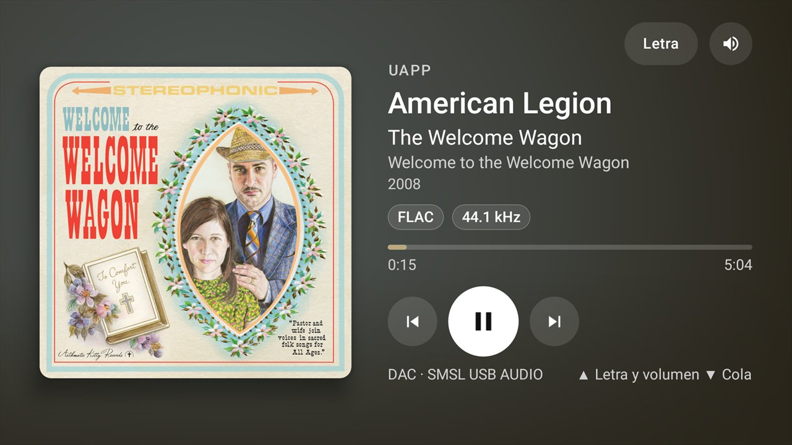

DAC Stage never decodes, resamples or sends audio anywhere. Your music app (UAPP, HiBy Music or any other
player) keeps playing natively to the DAC; DAC Stage only reads what is playing, sends transport commands
and talks to the DAC over USB for volume and mute.

> Screenshots show the Spanish UI. The app is available in English and Spanish and follows the system language.

---

## Contents

- [How it works](#how-it-works)
- [Features](#features)
- [Screenshots](#screenshots)
- [Requirements](#requirements)
- [Supported players](#supported-players)
- [Compatible DACs](#compatible-dacs)
- [Getting started](#getting-started)
- [Using the TV remote](#using-the-tv-remote)
- [DAC volume safety](#dac-volume-safety)
- [Privacy and network](#privacy-and-network)
- [Known limitations](#known-limitations)
- [Building from source](#building-from-source)
- [Project structure](#project-structure)
- [Testing](#testing)
- [License](#license)

---

## How it works

One APK, three roles:

| Role | Device | What it does |
|---|---|---|
| **Host** | The phone or tablet with the USB DAC | Your music app plays to the DAC. DAC Stage publishes what is playing, receives commands and is the only one that talks USB to the DAC (hardware volume and mute). |
| **TV** | Android TV / Google TV | Display and remote: transport, queue, lyrics and DAC volume, plus a screensaver. It does not play audio, has no library and does not stream. |
| **Remote control** | Any other phone or tablet | The same controls as the TV, touch-friendly and without the screensaver. Shows up as a media session in Android (notification, lock screen, volume keys). |

On a TV the role is always *TV*. On a phone or tablet you choose it the first time (host or remote) and can
change it later.

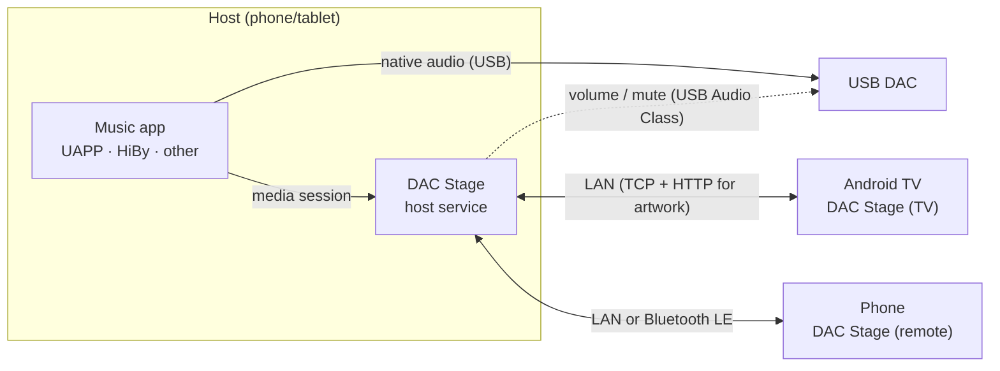

The host and its clients find each other with NSD/mDNS (`_dacstage._tcp`) on the local network. If your
Wi‑Fi isolates devices from each other (client/AP isolation), a phone remote can connect to the host over
**Bluetooth LE** instead, with no router involved; a TV on Ethernet usually still reaches the host.

---

## Features

### TV

- **Now playing** with large artwork, title, artist, album, year, format chips (codec, sample rate, bit
  depth when the player provides them) and progress.
- **Artwork-driven colors**: the background gradient and accents are taken from the album cover.
- **Synced lyrics** from [LRCLIB](https://lrclib.net), line by line, with a fallback for unsynced lyrics.
  Songs without lyrics stay in lyrics mode and say so instead of jumping out.
- **Queue band**: browse the player's queue with the D-pad and jump to any track.
- **DAC volume panel**: ±1 dB steps, mute, the limit set on the host, and the value **read back from the DAC**.
- **Screensaver** after 5 minutes without using the remote (configurable): optional
  [Google Earth View](https://earthview.withgoogle.com) satellite photos with place and credits, the current
  song, and optionally the lyrics over the photo.
- **Host chooser**: prefers the paired host, lets you pick another one or type the host's IP.

### Host (phone or tablet with the DAC)

- Adaptive layout for phones and tablets: now playing, queue and a DAC panel with the real sample rate
  (read from the DAC's clock source), USB link bit depth and hardware volume.
- Foreground service that keeps running while your music app plays.
- Settings for the volume limit, TV pairing, the UAPP queue reader, online info (lyrics, MusicBrainz),
  the TV screensaver and Bluetooth remotes.

### Remote control (phone)

- Single-screen layout with no scrolling: artwork, track info, transport, lyrics, queue sheet and DAC volume.
- **Swipe the artwork** left or right for next or previous track, with a carousel that shows the
  neighbouring covers from the queue.
- **Android media integration**: media notification, lock-screen controls, and the phone's hardware volume
  keys adjust the DAC volume (within the host's limit).
- Stays connected with the screen off (foreground service, stops when you close the app).
- Connects over the network or over **Bluetooth LE** when the Wi‑Fi isolates devices.

---

## Screenshots

### TV

| Now playing | Synced lyrics |
|---|---|
|  | 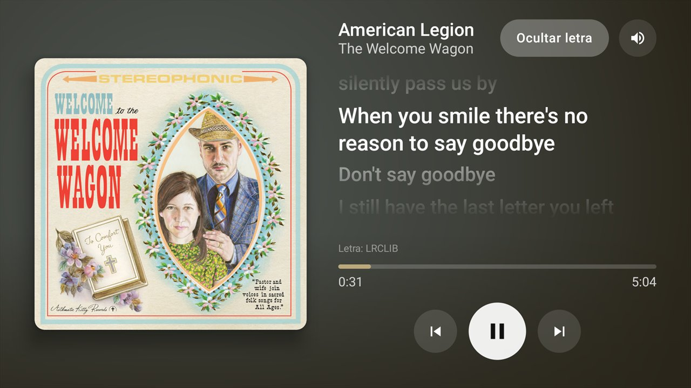 |

| Queue | DAC volume |
|---|---|
| 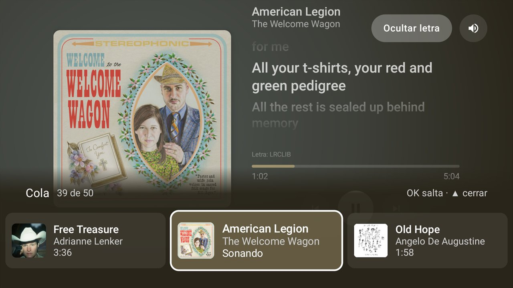 | 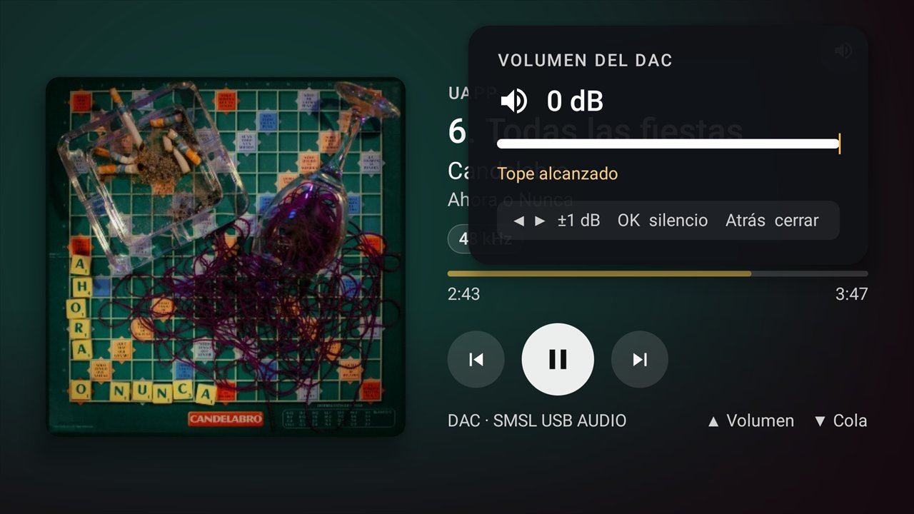 |

| Screensaver with lyrics | Screensaver |
|---|---|
|  | 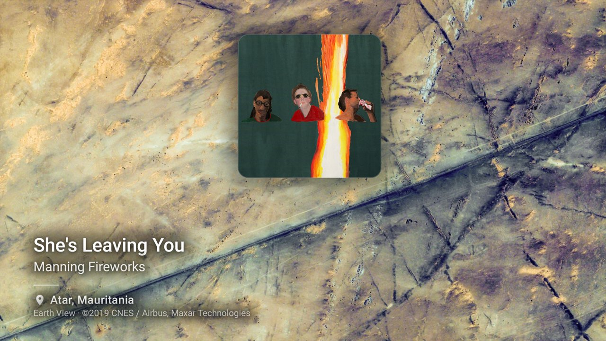 |

| Pairing |
|---|
| 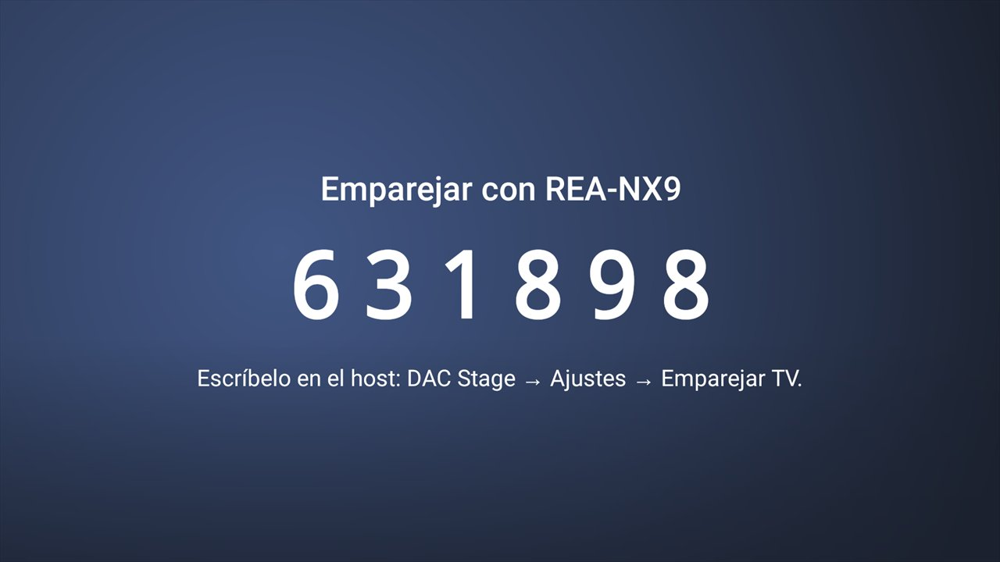 |

### Host (tablet)

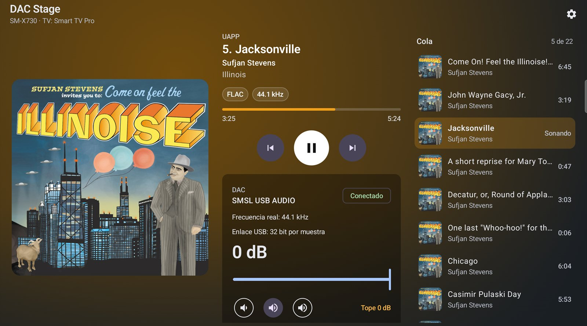

### Remote control (phone)

| Now playing | Queue | First launch |
|---|---|---|
| 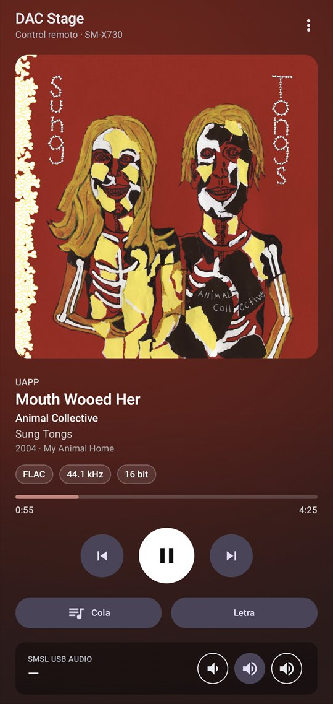 | 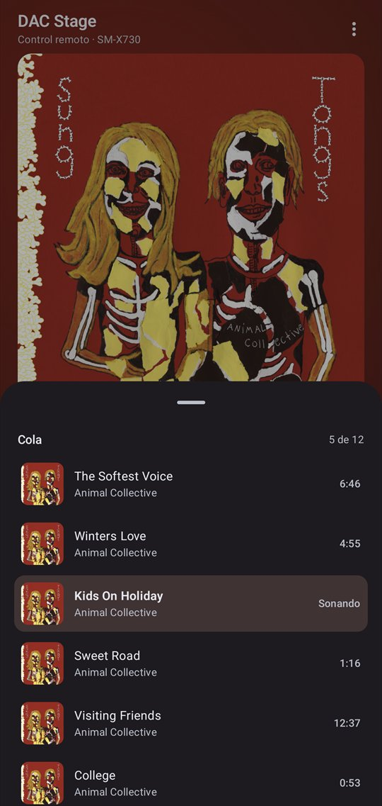 | 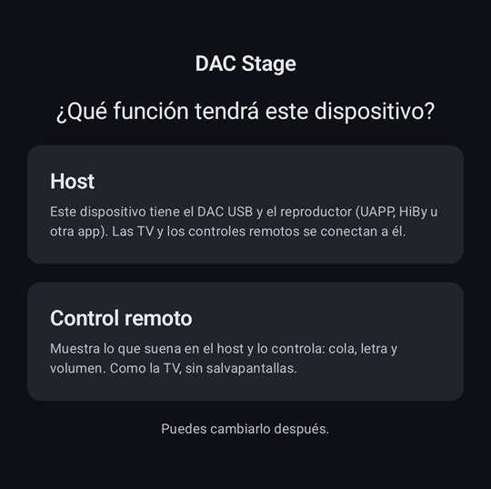 |

---

## Requirements

- **Host**: Android 11 (API 30) or later, USB OTG, a USB DAC (see [Compatible DACs](#compatible-dacs)) and a
  music app that plays to it (see [Supported players](#supported-players)). Developed with a Samsung Galaxy
  Tab S11 and an SMSL USB DAC.
- **TV**: Android TV / Google TV with Android 11 or later.
- **Remote**: any phone or tablet with Android 11 or later. Bluetooth LE is needed only for the Bluetooth
  connection.
- All devices on the same local network, or the remote within Bluetooth range of the host.

---

## Supported players

| Player | Now playing | Transport | Queue | Format chips | DAC hardware volume |
|---|---|---|---|---|---|
| **UAPP** (USB Audio Player PRO) | ✓ | ✓ | ✓ optional, see [UAPP queue](#uapp-queue-optional) | ✓ | ✓ |
| **HiBy Music** | ✓ | ✓ | ✓ (its current queue) | — (HiBy doesn't publish them) | ✓ |
| **Any other app** with a media session (Spotify, YouTube Music, Poweramp…) | ✓ | ✓ | ✓ if the app publishes it | — | See below |

### Generic apps

DAC Stage works with **any music app that publishes an Android media session**, which is almost every player
and streaming app. Through that session it gets the title, artist, album, artwork, progress and transport,
plus the queue if the app publishes it (jumps use `skipToQueueItem`). The TV and the remote show the app's
real name.

What changes compared with UAPP and HiBy:

- **No format chips**: media sessions don't include codec, sample rate or bit depth.
- **Volume**: most of these apps play through Android's own audio stack, which then holds the DAC. In that
  case DAC Stage doesn't touch the DAC over USB; the TV and the remote adjust **Android's media volume**
  instead of the DAC's hardware volume. Audio quality in that path depends on Android, not on DAC Stage.
- **Safety**: if another app is playing, DAC Stage never takes the DAC's control interface without your
  confirmation.

DAC Stage only uses what Android exposes to any app (media sessions, with notification access) and, for the
UAPP queue, files on your own device. It never calls `playFromSearch` or `playFromMediaId` (in UAPP they
clear the queue); a unit test enforces it.

---

## Compatible DACs

Everything except the volume works with any DAC: now playing, queue, lyrics and the screensaver come from
the player, not from the DAC. For the **hardware volume**, DAC Stage reads the DAC's USB descriptors and
adapts to what it finds:

| What the DAC exposes | What DAC Stage does |
|---|---|
| USB Audio Class 2 with a volume control and a valid dB range | Full control: volume in dB, mute, real sample rate from the clock source |
| USB Audio Class 1 with a volume control | Volume and mute; the sample rate isn't read (UAC1 only reports it on the streaming endpoint) |
| Volume control without a reliable dB scale (tiny, inverted or nonsensical range) | Volume isn't changed from the app; you adjust it on the DAC |
| Volume declared but stuck or read-only | Treated as fixed: adjust it on the DAC |
| No USB volume control at all | Volume is adjusted on the DAC; mute is used if the DAC has it |

**Tested on real hardware:** SMSL USB DAC (USB ID `152A:85DD`), with a Samsung Galaxy Tab S11 as host.

**Known quirks applied, not tested with DAC Stage:** the volume code includes fixes taken from the Linux
kernel's USB audio quirk tables for these devices. They should behave correctly, but nobody has confirmed it
on DAC Stage yet:

| Device | USB ID | Adjustment |
|---|---|---|
| MOONDROP Quark2 | `3302:12DB` | Raised minimum (silences below it) |
| MOONDROP JU Jiu | `31B2:0111` | Raised minimum |
| Huawei CM-Q3 | `12D1:3A07` | Raised minimum |
| C-Media CM102 | `0D8C:0103` | Raised minimum |
| ESS "Asus USB DAC" | `0495:3042` | Non-standard volume units |
| AudioQuest DragonFly | `21B4:0081` | Volume table; sample rate not read |
| Schiit Hel | `30BE:0101` | Retries control requests that fail spuriously |
| Samsung/AKG USB-C adapter | `04E8:A051` | Skips the clock selector; spaced requests |
| Comture-based devices (iBasso, MOONDROP) | `2FC6:*` | Spaced control requests |
| MOONDROP Moonriver2 Ti | `2FC6:F06B` | Wider spacing between requests |
| RME ADI-2 | `2A39:3FD2`–`3FD4` | Fixed volume (adjusted on the DAC) |
| JBL Pebbles | `05FC:0231` | Linear volume; sample rate not read |
| Hotone Pulze Mini | `84EF:0082` | Linear volume |
| MV-SILICON chips (by manufacturer name) | — | Linear volume when the range is 0–4096 |

Any other DAC goes through the generic path described above. If you try one, please
[open an issue](https://github.com/dorregor/dacstage-android-dac-streamer/issues) with its name, USB ID and
what worked: that's how this list grows.

---

## Getting started

Releases are not published yet: [build the APK](#building-from-source) and install it on each device.

```powershell
$adb = "<SDK path>\platform-tools\adb.exe"
& $adb -s <tv-ip>:5555 install -r app\build\outputs\apk\release\app-release.apk         # TV
& $adb -s <tablet-ip>:<port> install -r app\build\outputs\apk\release\app-release.apk   # host
& $adb -s <phone-ip>:<port> install -r app\build\outputs\apk\release\app-release.apk    # remote
```

### 1. Host

1. Connect the DAC and open DAC Stage. Choose **Host**.
2. Grant **notification access** when asked. It lets DAC Stage read your player's media session; it does not
   read your notifications.
3. Accept the **USB permission** for the DAC. Reinstalling the app resets it.
4. Start playing music in your app. The host shows a persistent "Host active" notification.

### 2. TV

1. Open DAC Stage on the TV. It looks for the host on the network (or tap **Enter host IP**; the host shows
   its address in *Settings → Pair TV*).
2. The TV shows a **6-digit code**.
3. On the host: *Settings → Pair TV* → enter the code. Reconnections authenticate automatically from then on.
4. To unpair: *Settings → Paired TVs → Forget* on the host.

### 3. Phone remote (optional)

1. Open DAC Stage on the phone and choose **Remote control**.
2. It finds the host on the network or, if Bluetooth is on and allowed, over Bluetooth
   (*Settings → Remote controls over Bluetooth* must be enabled on the host; it is on by default).
3. Pair it with the code exactly like a TV.
4. To turn the phone back into a host: menu **⋮ → Use as host**.

### UAPP queue (optional)

UAPP doesn't publish its queue through its media session. DAC Stage can read it from UAPP's own files
(`PlayQueue.xml`, `PosA.txt`, `PosB.txt`), which a regular app can't access on Android 11+. To do that it uses
the host's **own wireless debugging** as a local ADB client:

1. *Settings → Read the UAPP queue* on the host.
2. *Developer options → Wireless debugging* → on → **Pair device with pairing code**.
3. Enter the 6-digit code in DAC Stage.

The link is local to the device and limited to reading those three files (allow-list, `cat`/`stat` only).
Wireless debugging turns off after a reboot or a Wi‑Fi change; turn it on again to see the queue. Without it,
the UAPP queue is simply hidden.

---

## Using the TV remote

| Screen | Keys |
|---|---|
| Now playing | D-pad moves between controls, OK presses · ▲ lyrics and volume · ▼ queue |
| Queue | ◀ ▶ browse · OK jump to track · ▲ close |
| DAC volume | ◀ ▶ ±1 dB · OK mute · Back close |
| Long jumps in UAPP | Back cancels |

From any screen, the remote's media keys (play/pause, next, previous) control the player, and its volume and
mute keys control the **DAC** volume through the host, with the same limits.

---

## DAC volume safety

The DAC volume is digital attenuation in the DAC itself, so DAC Stage treats it carefully:

- The **host** enforces it, also for commands coming from the TV or a remote: a configurable limit
  (default: 10 dB below the DAC's maximum), 1 dB steps, gradual acceleration when holding a key, and mute
  always available. Clients can't change the limit or request an absolute volume.
- The value shown is always the one **read back from the DAC**, never the requested one.
- If the player holds the DAC's audio control interface, taking it over requires `claimInterface(true)`.
  DAC Stage does that silently only while paused. **While music is playing** it needs your confirmation on
  the host ("Always allow with <player>", stored per DAC and player, revocable) or "Pause and apply";
  otherwise the TV shows "Volume not available right now".
- If an app other than UAPP or HiBy is playing, DAC Stage never takes control of the DAC without confirmation.
- When jumping several tracks in UAPP, the DAC is muted during the jump (only when it is safe to take the
  interface) so you don't hear the start of each skipped song.

---

## Privacy and network

- **No accounts, no analytics, no streaming credentials.** DAC Stage doesn't use any streaming service API.
- **Online info is optional** (host settings). Only the title, artist, album and duration of the current
  track are sent to [LRCLIB](https://lrclib.net) (lyrics) and [MusicBrainz](https://musicbrainz.org) /
  Cover Art Archive (year, label, cover). If the match isn't confident, nothing is shown.
- **Earth View** photos are downloaded by the TV; nothing about you or your music is sent.
- **LAN protocol**: line-delimited JSON on port 47820 and artwork over HTTP on 47821 (with a token). If those
  ports are busy the next free ones are used and announced via NSD. Pairing uses a 6-digit code on the host;
  reconnections are authenticated with an HMAC of a shared token. The traffic is **not encrypted**: the
  token travels in clear once, during pairing. Use it on a network you trust.
- **Bluetooth**: the host advertises a BLE service and remotes connect over an L2CAP channel. Pairing still
  needs the code on the host. Artwork from local files isn't shown over Bluetooth.

---

## Known limitations

- **UAPP queue** needs wireless debugging (see above). UAPP doesn't implement `skipToQueueItem`, so jumps are
  done as N × next/previous (up to 40 steps, cancellable); the TV shows "Skipping…". If the files and the
  session disagree, the queue is hidden rather than guessed.
- **HiBy**: the TV only browses HiBy's current queue (its media browser only exposes the local library). HiBy
  doesn't publish format or bitrate, so those chips don't appear.
- **DAC**: there is no source selector over USB. The DAC doesn't report knob changes, so the volume is read
  again when the host opens, on track changes and after each change. The real sample rate comes from the
  DAC's clock source.
- **Artwork**: UAPP's CDN artwork is requested at 1280×1280 (with 1080 and original as fallbacks); HiBy
  provides its own. The highest real resolution is used and never upscaled. Logs: `adb logcat -s DacStageArt`.
- **APK size** is about 21 MB in release, mostly Conscrypt/Bouncy Castle for the local ADB client.

---

## Building from source

Requirements: JDK 17 or later (tested with 25) and the Android SDK with `platforms;android-37.0`
(`local.properties` → `sdk.dir`).

```powershell
.\gradlew.bat assembleDebug          # app\build\outputs\apk\debug\app-debug.apk
.\gradlew.bat assembleRelease        # R8 + resource shrinking
.\gradlew.bat :app:testDebugUnitTest # unit tests
```

On macOS/Linux use `./gradlew`.

- **Release signing**: create `keystore.properties` in the project root (`storeFile`, `storePassword`,
  `keyAlias`, `keyPassword`). Without it, the release build is signed with the debug key.
- **Your own fork**: set `dacstage.projectUrl` in `gradle.properties` to your repository URL. It goes in the
  User-Agent sent to MusicBrainz and LRCLIB, which ask clients to identify themselves.
- **Baseline Profile** (optional, faster TV startup): with the app installed on the TV and only the TV
  connected through adb (or `ANDROID_SERIAL=<tv-ip>:5555`), run `.\gradlew.bat :app:generateBaselineProfile`.
  The profile is saved in `app/src/release/generated/baselineProfiles/` and used by the next release build.

Tech stack: Kotlin, Jetpack Compose (Material 3 and TV Material), coroutines/Flow, kotlinx.serialization,
Coil 3, AndroidX Media, Android USB host API (USB Audio Class 1 and 2), NSD and Bluetooth LE L2CAP.

---

## Project structure

```
app/src/main/java/io/github/dacstage/
  model/        Shared state and commands (the only thing that travels over the network)
  host/         HostService (foreground service), HostGraph, HostCore, settings
  dac/          UsbAudioDacController (UAC2), descriptor parser, DacVolumeManager (policy)
  players/      Session monitor; hiby/ (queue + jump by queueId); uapp/ (transport, files, stepper, local ADB)
  network/      Protocol, HostServer, TvHostClient, NSD, pairing, artwork HTTP server, Bluetooth link
  artwork/      Host-side artwork resolution (highest real resolution, hash, cache)
  enrich/       LRCLIB and MusicBrainz clients
  tv/ ui/       TV ViewModel; ui/common, ui/tv (D-pad), ui/mobile (adaptive host and phone remote)
app/src/debug/  Demo mode and previews (debug only: `--es demo <scenario>`)
baselineprofile/ Baseline Profile generator (run manually on the TV)
tools/hostctl.ps1 Test client that acts like a TV
docs/           On-device test guide and screenshots
.claude/skills/ Design and engineering guidelines used while developing the project
```

---

## Testing

- Unit tests: `.\gradlew.bat :app:testDebugUnitTest` (protocol and host server, volume policy and dB
  scaling, UAC2 descriptor parsing, UAPP parsers, queue sync and stepper, lyrics/MusicBrainz, Earth View
  parsing, TV key mapping, UI state).
- On-device test guide: [docs/PRUEBAS.md](docs/PRUEBAS.md) (Spanish).
- `tools/hostctl.ps1` connects to a host like a TV, useful to test the protocol from a PC.
- Logcat tags: `DacStageHost`, `UsbAudioDac`, `SessionMonitor`, `UappAdapter`, `UappAdb`, `DacStageNet`,
  `DacStageArt`.

Bug reports and pull requests are welcome. Please include your DAC model, player app and Android version.

---

## License

DAC Stage is released under the [MIT License](LICENSE). Bundled libraries, the optional online services and
the trademarks mentioned here are listed in [THIRD_PARTY_NOTICES.md](THIRD_PARTY_NOTICES.md).

DAC Stage is an independent project, not affiliated with or endorsed by the developers of UAPP, HiBy, TIDAL
or SMSL. It contains no code or binaries from those apps and uses no credentials or private APIs of streaming
services. Album artwork, lyrics and Earth View photos visible in the screenshots belong to their respective
rights holders and are shown only to illustrate the app.
